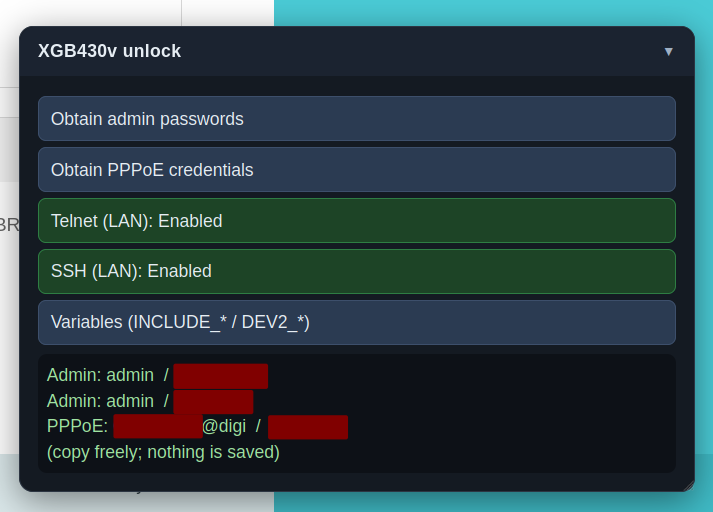
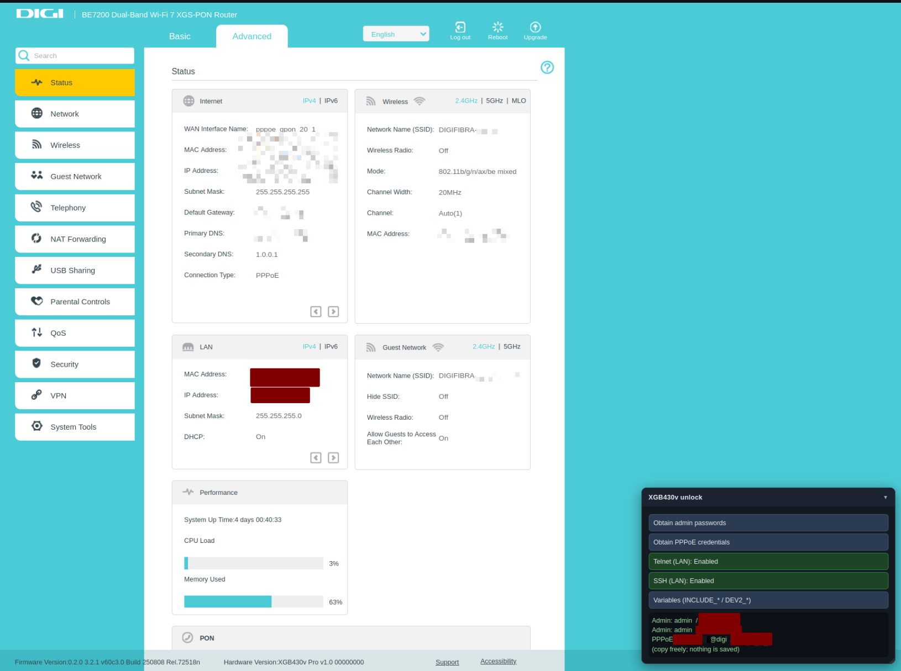

# XGB430v unlock

[](https://raw.githubusercontent.com/tasarren/digi-router-unlocker/main/unlock.user.js)
[](https://raw.githubusercontent.com/tasarren/digi-router-unlocker/main/unlock.user.js)
[](https://raw.githubusercontent.com/tasarren/digi-router-unlocker/main/unlock.user.js)

[Español](README.md) · [Variables reference: `VARIABLES.md`](VARIABLES.md)

Unlocks every hidden menu in the **Digi TP-Link XGB430v Pro** (XGS-PON BE7200 Wi-Fi 7) web UI:
QoS, Security, VPN, GPON WAN settings, 3G/4G, the full Firewall page, SFU VLAN, CATV, Application List,
TR-369, Telnet, SSH...

In short: everything the ISP-restricted account does not let you see.

Tested on: **Digi TP-Link XGB430v Pro, hardware v1.0, firmware `0.2.0 3.2.1 v60c3.0 Build 250808 Rel.72518n`**
(`Hardware Version:XGB430v Pro v1.0`). I have not tested other hardware or firmware revisions; they may work
or they may not. Open an issue if it does not work for you.



| With the script | Default (ISP) |
| --- | --- |
|  |  |

## Install

Two ways:

**A. Userscript manager (Tampermonkey / Violentmonkey)**

1. Install the extension in your browser.
2. Create a new script, paste the contents of `unlock.user.js`, save.
3. Open the router UI and reload.

**B. Browser extension (Manifest V3)**

1. `chrome://extensions` (or `edge://extensions`).
2. Enable **Developer mode**.
3. **Load unpacked** → select this repository folder (the one with `manifest.json`).

The manifest injects `unlock.user.js` at `document_start`, into the page's `MAIN` world and in all frames;
that combination is required to run before `oid_str.js` freezes the flag.

## Change the router IP

The script only runs where it is told to. It defaults to `192.168.1.1`; if your router uses another address
(check the label on the device or your default gateway: `ip route`, `ipconfig /all`, Settings → Network),
change it in both places:

**1. `unlock.user.js`, lines 4 and 5:**

```js
// @match        http://192.168.1.1/*
// @match        https://192.168.1.1/*
```

Change `192.168.1.1` to your router IP on both lines; for example:

```js
// @match        http://192.168.0.1/*
// @match        https://192.168.0.1/*
```

**2. `manifest.json`, line 8:** same thing, `matches` goes from

```json
"matches": [
  "http://192.168.1.1/*",
  "https://192.168.1.1/*"
]
```

to, for example:

```json
"matches": [
  "http://192.168.0.1/*",
  "https://192.168.0.1/*"
]
```

**3. Reload:** if you use the userscript, reinstall or re-enable it; if you use the extension, press its
reload button. Then reload the router page.

## What it does

The firmware ships about 1600 feature flags (`INCLUDE_*`) in `js/oid_str.js`. One of them,
`INCLUDE_USER_RESTRICTION`, hides the menus from the restricted account, and the firmware freezes it at boot:

```js
Object.defineProperty(window, 'INCLUDE_USER_RESTRICTION', {value: 1, writable: false});
```

Because it is non-configurable, neither devtools nor bookmarklets can change it after the page loads. So this
project runs **before** `oid_str.js` and rewrites that single `defineProperty` call:

```js
const define = Object.defineProperty;
Object.defineProperty = function (target, prop, descriptor) {
    if (target === window && prop === 'INCLUDE_USER_RESTRICTION') {
        descriptor = {value: 0, writable: true, configurable: true};
    }
    return define(target, prop, descriptor);
};
```

## Recommended: keep the ISP out of your box

The script only changes what the browser renders. The ISP still has a management channel into the router
(TR-069/CWMP) and can push changes, undo yours, or update the firmware without you noticing. Before changing
anything:

1. **Turn off remote management**: Administration → "Manage this Router via the Address". Disable it.
2. **Turn off TR-069 / ACS** if your firmware exposes the option (look for TR-069 or CWMP under Network or
   Management). That is the channel the ISP uses to provision the box and undo your changes.
3. **Set a strong admin password** on the Administration page while you are there.

Remember: this is all client side; the ISP's server-side policy still wins.

### Unlocked vs default

| Unlocked (script) | Default (ISP) |
| --- | --- |
| **Basic → Internet**: menu entry to set up the WAN/4G connection | Internet does not appear anywhere in the Basic menu |
| **Basic → USB Sharing → 3G/4G Settings**: USB modem settings (APN, PIN, dial number, manual dial) | USB Sharing only has USB Storage Device |
| **Network → Internet**: broadband/WAN connection page | entry missing |
| **Network → GPON WAN**: XGS-PON service page (GPON Settings: PPPoE `pppoe_gpon_20_1`, VLAN 20, IPoE) | entry missing and the page cannot be opened |
| **Network → Static Routing**: static route table (add, modify, delete) | entry missing |
| **Network → RIP Settings**: RIP protocol configuration | entry missing |
| **Network**: full submenu (Internet, GPON WAN, GPON Settings, LAN Settings, Dynamic DNS, Static Routing, RIP) | only LAN Settings and Dynamic DNS remain |
| **QoS**: menu section with its Traffic Control page (VoIP QoS, priority bands High 60% / Middle 30% / Low 10%, per-device QoS rule list) | no QoS menu |
| **VPN**: menu section with OpenVPN server, PPTP VPN, IPSec VPN and VPN Connections pages | no VPN menu |
| **Telephony**: full submenu; adds Telephone Book, Digit Map, DND & Call Blocking and Call Forwarding | only Telephone Number and Call Log |
| **System Tools → Firmware Upgrade**: upgrade page with hardware/firmware versions and serial number | entry missing |
| **System Tools → System Log**: log viewer with filtering and export | entry missing |
| Same on both: Status, Network Map, Wireless, Guest Network, Multi-SSID, basic Telephony, NAT Forwarding (ALG, Virtual Servers, Port Triggering, DMZ, UPnP), USB Storage Device, Parental Controls, Security, Diagnostics, Administration and Mesh | all of that works without the script |

## Screenshots

| Page | Script | Default |
| --- | --- | --- |
| VPN | <a href="screenshots/adv-vpn-patched.png"></a> | Not available |
| Static routing | <a href="screenshots/adv-network-static-routing-patched.png"></a> | Not available |
| QoS Traffic | <a href="screenshots/adv-qos-traffic-patched.png"></a> | Not available |
| GPON WAN | <a href="screenshots/adv-network-gpon-patched.png"></a> | Not available |
| RIP | <a href="screenshots/adv-network-rip-patched.png"></a> | Not available |
| Logs | <a href="screenshots/adv-logs-patched.png"></a> | Not available |
| Firmware update | <a href="screenshots/adv-firm-update-patched.png"></a> | Not available |
| 4G router | <a href="screenshots/adv-4g-router-patched.png"></a> | Not available |
| 4G (Basic) | <a href="screenshots/4g-router-patched.png"></a> | Not available |
| Gateways | <a href="screenshots/adv-network-gateways-patched.png"></a> | Not available |
| Phone book | <a href="screenshots/adv-telephony-book-patched.png"></a> | Not available |
| Call forwarding | <a href="screenshots/adv-telephony-call-forward-patched.png"></a> | Not available |
| DND & call block | <a href="screenshots/adv-telephony-dnd-call-block-patched.png"></a> | Not available |
| Advanced | <a href="screenshots/advanced-patched.png"></a> | <a href="screenshots/advanced-default.png"></a> |
| Home | <a href="screenshots/home-patched.png"></a> | <a href="screenshots/home-default.png"></a> |
| Administration | <a href="screenshots/adv-admin-patched.png"></a> | <a href="screenshots/adv-admin-default.png"></a> |
| Telephony | <a href="screenshots/adv-telephony-patched.png"></a> | <a href="screenshots/adv-telephony-default.png"></a> |

"Not available" means the page is hidden by default under the ISP restriction, so no default screenshot exists.
